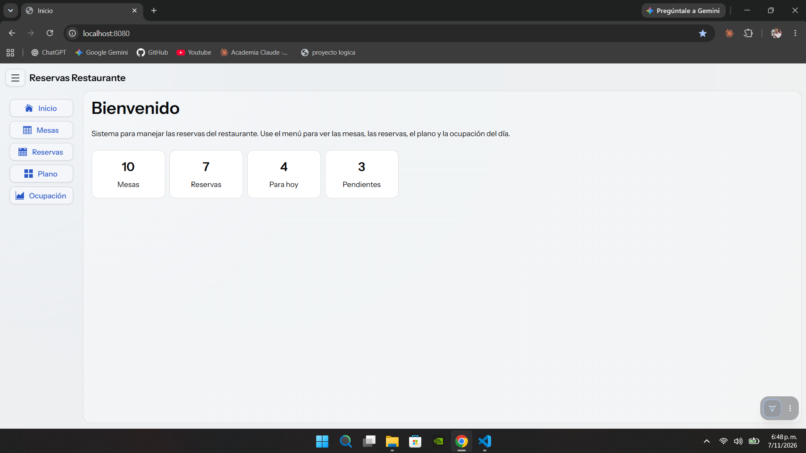
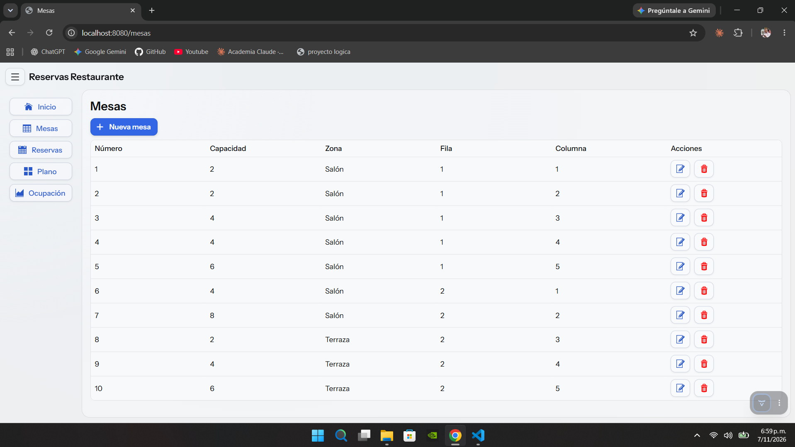
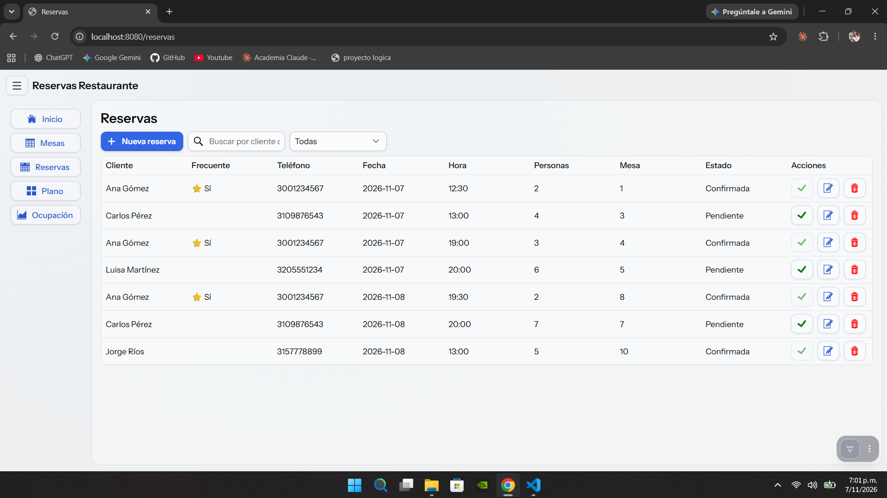
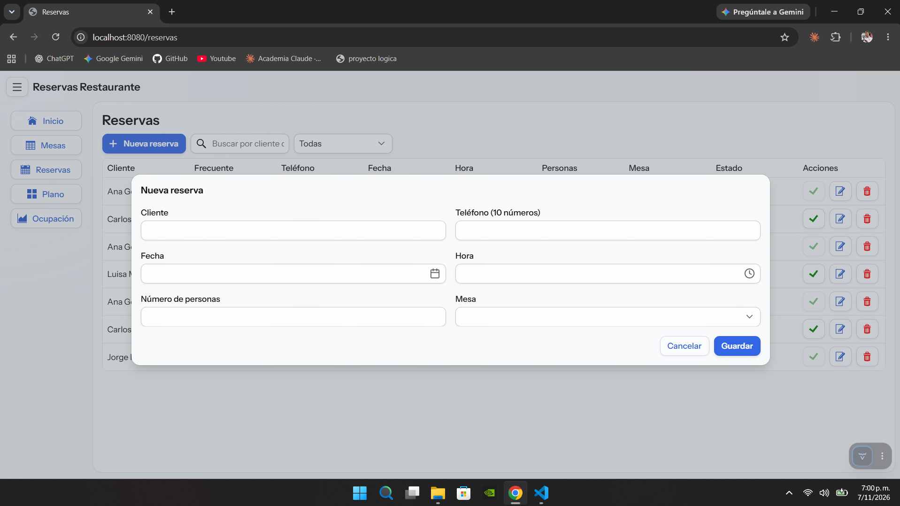
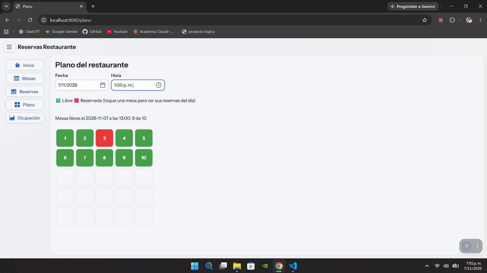
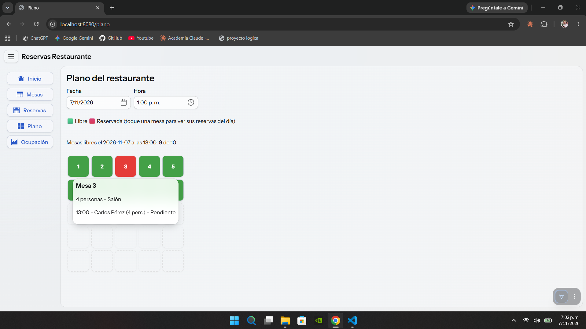
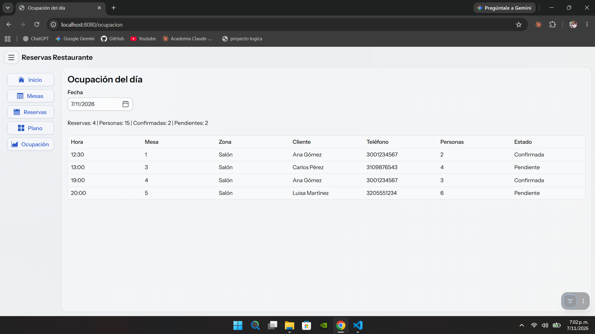

# Reservas de restaurante

Proyecto final de **Lógica de Programación** — Proyecto 6 de 15.

Aplicación web hecha en Java con Vaadin para que un restaurante maneje sus reservas: registrar las mesas con su posición en el plano, crear reservas validando capacidad y horario, ver de un vistazo qué mesas están libres o reservadas para una fecha y hora, y revisar la ocupación de cada día. Todos los datos se guardan en archivos de texto.

- **Autor:** Samuel Grajales Ortiz
- **Fecha:** 11 de noviembre de 2026
- **Profesor:** Daniel Jesús Castillo Botero

---

## Tecnologías

- Java 21
- Spring Boot (proyecto creado con Spring Initializr desde VS Code)
- Vaadin 25 (solo componentes gratuitos)
- Maven
- Archivos de texto `.txt` con los campos separados por `|` (sin base de datos)

## Cómo ejecutarlo

**Requisitos:** JDK 21 instalado y VS Code con el *Extension Pack for Java*.

1. Clonar o descargar el repositorio y abrir la carpeta `reservas` en VS Code.
2. Abrir `src/main/java/com/restaurante/ReservasApplication.java` y hacer clic en **Run** encima de `main`.
   También se puede ejecutar desde la terminal, dentro de la carpeta del proyecto:
   ```
   .\mvnw spring-boot:run
   ```
3. Esperar el mensaje `Started ReservasApplication` y abrir **http://localhost:8080** en el navegador.

La primera vez puede tardar un poco más, porque Vaadin prepara el frontend.

## Datos de ejemplo

La aplicación guarda los datos en dos archivos que quedan en la carpeta del proyecto:

| Archivo | Contenido | Ejemplo de línea |
|---|---|---|
| `mesas.txt` | número, capacidad, zona, fila, columna | `3\|4\|Salón\|1\|3` |
| `reservas.txt` | id, cliente, teléfono, fecha, hora, personas, mesa, confirmada | `1\|Ana Gómez\|3001234567\|2026-11-11\|12:30\|2\|1\|true` |

**La primera vez que se ejecuta**, si los archivos no existen, la aplicación los crea sola con datos de ejemplo: 10 mesas (salón y terraza) y 7 reservas para el día de hoy y mañana, para poder probar todo sin llenarlo a mano. Una de las clientas (Ana Gómez) tiene 3 reservas, para ver el cliente frecuente.

Para volver a los datos de ejemplo: detener la aplicación, borrar `mesas.txt` y `reservas.txt` y ejecutarla otra vez.

Si una línea de un archivo está mal escrita, la aplicación la salta y sigue funcionando con las demás.

---

## Manual de uso

La aplicación tiene un menú a la izquierda con 5 vistas. En el celular el menú se esconde y se abre con el botón de tres rayitas de arriba.

### 1. Inicio

Resumen con la cantidad de mesas, reservas totales, reservas para hoy y reservas pendientes.



### 2. Mesas

Tabla con todas las mesas.

- **Nueva mesa:** abre un formulario con número, capacidad, zona y posición (fila y columna) en el plano.
- **Lápiz:** edita la mesa (el número no se puede cambiar porque las reservas lo usan).
- **Caneca roja:** elimina la mesa, preguntando antes de hacerlo.

Validaciones: los datos deben ser números enteros, la capacidad entre 1 y 12, la fila y la columna entre 1 y 5, el número y la posición no se pueden repetir, una mesa con reservas no se puede eliminar, y no se le puede bajar la capacidad por debajo de su reserva más grande.



### 3. Reservas

Tabla con todas las reservas.

- **Buscador:** filtra mientras se escribe, por nombre del cliente o por teléfono.
- **Filtro:** Todas, Pendientes o Confirmadas.
- **Nueva reserva:** formulario con cliente, teléfono, fecha, hora y número de personas, y la mesa. La hora se elige cada 30 minutos dentro del horario del restaurante (12:00 a 22:00).
- **✔ verde:** confirma una reserva pendiente.
- **Lápiz:** edita la reserva.
- **Caneca roja:** cancela la reserva, preguntando antes de hacerlo.
- **Columna Frecuente:** muestra ⭐ cuando el cliente (por su teléfono) tiene 3 o más reservas.

Validaciones: nombre obligatorio, teléfono de 10 números, fecha y hora que no hayan pasado, hora dentro del horario, personas entre 1 y la capacidad de la mesa, y la misma mesa no se puede reservar dos veces a la misma fecha y hora.





### 4. Plano

Se elige una fecha y una hora y se ve el plano del restaurante como una cuadrícula: cada mesa en su posición, en **verde** si está libre y en **rojo** si está reservada. Al tocar una mesa se abre una ventanita con su capacidad, su zona y sus reservas de ese día.





### 5. Ocupación del día

Se elige una fecha y se ven todas las reservas de ese día ordenadas por hora, con el total de reservas, de personas, de confirmadas y de pendientes.



---

## Componentes investigados

| Componente | Para qué se usa |
|---|---|
| **TimePicker** | Elegir la hora de la reserva cada 30 minutos y solo dentro del horario del restaurante (formulario de reservas y plano). |
| **Popover** | Al tocar una mesa del plano, mostrar sus reservas del día. |
| **ConfirmDialog** | Confirmar antes de cancelar una reserva y antes de eliminar una mesa. |

También se usaron `AppLayout` (menú) y `Grid` (tablas), que pide el enunciado.

## Estructura del proyecto

```
src/main/java/com/restaurante/
├── ReservasApplication.java   Arranca la aplicación
├── model/
│   ├── Mesa.java              Datos de una mesa
│   └── Reserva.java           Datos de una reserva
├── datos/
│   └── GestorArchivos.java    Lee y guarda los .txt
└── vistas/
    ├── MainLayout.java        Menú compartido (AppLayout)
    ├── InicioView.java        Inicio
    ├── MesasView.java         Mesas
    ├── ReservasView.java      Reservas
    ├── PlanoView.java         Plano del restaurante
    └── OcupacionView.java     Ocupación del día
```

## Bonificación

No se realizó.
